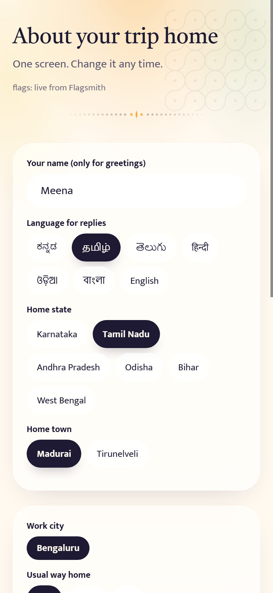
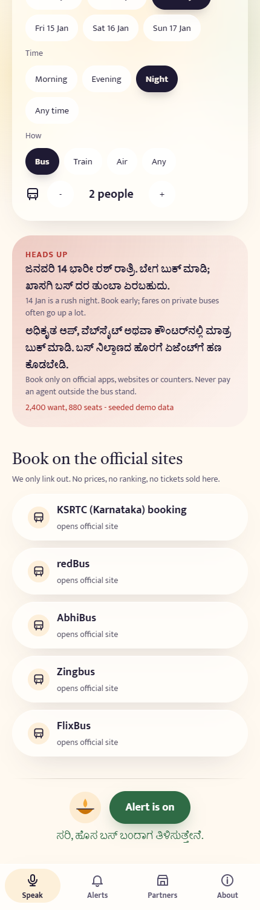
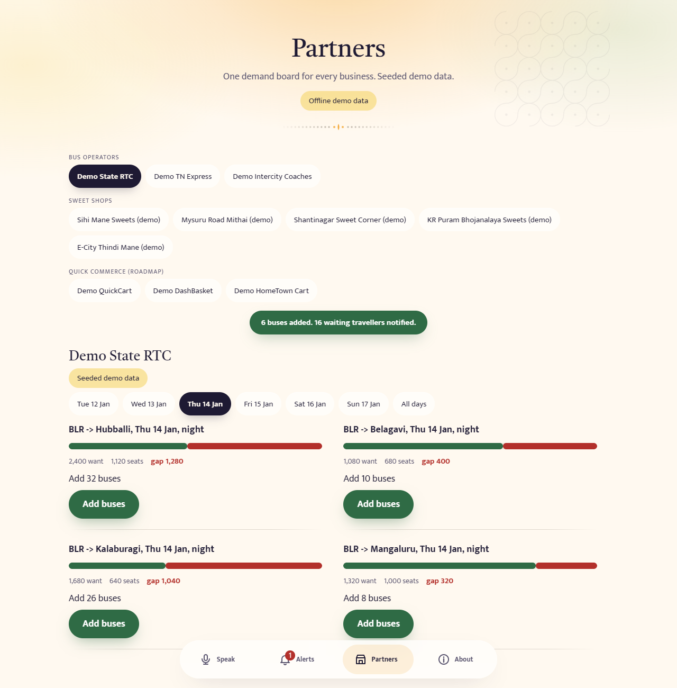
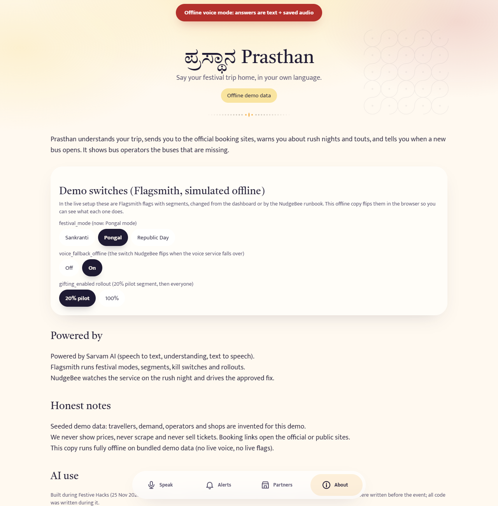
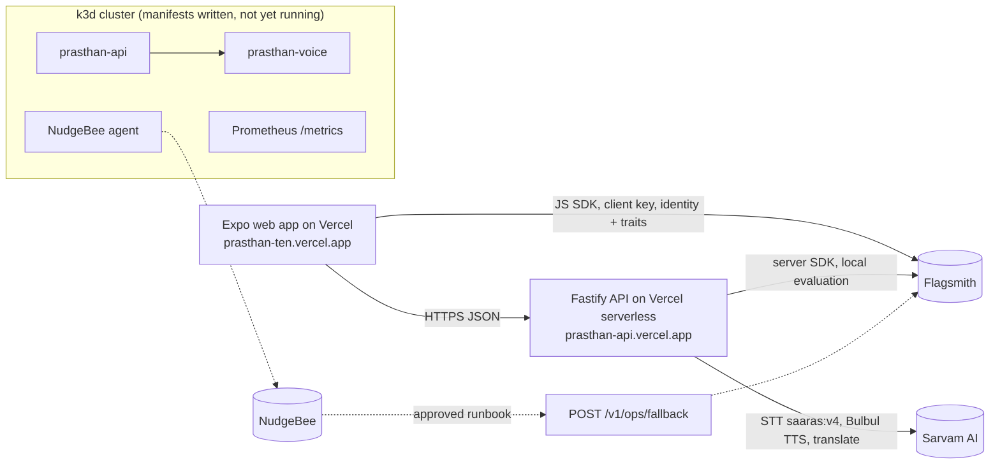

# Prasthan (ಪ್ರಸ್ಥಾನ, "setting out on a journey")

**Say your festival trip home in your own language. Prasthan understands it, sends you to the official booking page, warns you about rush nights and touts, and tells you the moment a new bus opens. And it shows bus operators the buses that are missing.**

> "redBus shows the buses that exist. We show operators the buses that are missing."

- **Web app (live):** https://prasthan-ten.vercel.app
- **API health (live):** https://prasthan-api.vercel.app/health (should say `"sarvam":"live","flagsmith":"live"`)
- **Demo video:** `<VIDEO_URL>`
- **52-second preview clip (Kannada audio):** [voice-and-traveller-flow.mp4](https://raw.githubusercontent.com/Ankith-m1006/prasthan/main/docs/img/voice-and-traveller-flow.mp4)

Built at Festive Hacks, 25 Nov 2026, BIEC Bengaluru. Sponsors: **Sarvam AI, Flagsmith, NudgeBee**.

## The problem
- Every festival, lakhs of people leave Bengaluru on the same two nights. Bengaluru "pretty much came to a standstill" on 17-18 Oct 2025 as people left for Deepavali.
- Private bus fares go 2-3x on those nights. Operators add special buses late, after the crowd is already at the bus stand.
- Travellers (and parents who may only speak Kannada, Tamil or Odia) keep refreshing four apps, and touts at Majestic fill the gap.

---

## Try it in 60 seconds (judges)
1. Open https://prasthan-ten.vercel.app (if the first answer is slow, the API is waking up: wait up to 20 s once).
2. **Continue as guest** -> fill the one-screen profile (name, language, home state + town, boarding point). Age group and gender are optional and never leave the device.
3. **Speak** tab: hold the mic and say your trip, or tap **or type** -> the Kannada sample. A trip card appears (Bengaluru -> Hubballi, night, bus, 2 people) and the reply is spoken back in Kannada by Sarvam.
4. See the rush-night + tout warning and the official booking links (redBus opens the real route page). Tap **Alert me**.
5. **Partners** tab -> **Demo State RTC** -> demand board (2,400 want, 880 seats) -> **Add buses** -> "N waiting travellers notified".
6. **Alerts** tab: the new-bus alert, spoken in Kannada.
7. **About** tab: "flags: live from Flagsmith" + the live flag values for your identity. Try a profile with home state **Tamil Nadu** -> Pongal mode (Flagsmith segment).

## Screenshots (live web app)

| Guest profile | Speak + trip card | Warnings, links, Alert me | Kannada new-bus alert |
|---|---|---|---|
|  |  |  |  |

Operator demand board after "Add 6 buses":



Live Flagsmith values on the About tab:



---

## What it does

**Traveller (Manjunath, home is Hubballi)**
1. Guest profile, no login: language, home town, boarding point, usual mode, who travels with him. "My usual trip home" builds a trip in one tap.
2. Speaks: *"ಸಂಕ್ರಾಂತಿಗೆ ಹುಬ್ಬಳ್ಳಿಗೆ ಊರಿಗೆ ಹೋಗ್ತಾ ಇದ್ದೀನಿ, ಗುರುವಾರ ರಾತ್ರಿ, ಬಸ್ಸಲ್ಲಿ, ಇಬ್ರು"*. Trip card: town, date, time, mode, people. Every field can be fixed with a tap; missing fields are filled from the profile.
3. Reply spoken in his language. Official booking links only (KSRTC, redBus route page, AbhiBus, Zingbus, FlixBus; IRCTC, ixigo). **No prices, no ranking, no scraping.**
4. Warnings: rush night + "book only on official apps; never pay an agent outside the bus stand". Booking hints from the profile (elders -> lower berth / senior concession; women -> ladies' seats, "ask at booking").
5. "Alert me when a new bus opens". When the operator adds buses, the alert arrives and is spoken in his language.

**Bus operator (Demo State RTC):** demand board per route and night: "BLR -> Hubballi: 2,400 want, 880 seats, gap 1,520". **Add buses** -> 6 buses, 22:30, Majestic -> waiting travellers are alerted.

**Sweet shop near Majestic:** pre-orders per pickup day ("Prepare 9 kg Mysore pak by 20:00"), behind a staged-rollout flag. **Quick commerce:** roadmap view on seeded data.

---

## Architecture



- **What runs today:** the Expo web build on Vercel calls the Fastify API on Vercel (one serverless function, `ROLE=all`). The API calls Sarvam for speech and reads Flagsmith flags; the app also reads Flagsmith directly with the public client-side key.
- **One codebase, one image:** `ROLE=all|api|voice`. If the voice service is down, or `voice_fallback_offline` is on, the API answers with the rule parser + text, so nobody is stranded.
- **Code:** `services/api` (Fastify 5 + TypeScript, 57 tests), `apps/mobile` (Expo, expo-router, react-native-web), `shared/contract/` (types + JSON Schemas), `infra/` (Docker, k8s, load test), `scripts/` (Flagsmith import, demo break/fix/reset). API contract: `docs/ARCHITECTURE.md`.

---

## How each sponsor is used (honest status)

### Sarvam AI: every traveller can speak, in their own language - LIVE
- **Saaras v4 STT** (`saaras:v4`, mode from the `stt_mode` flag, default `codemix` for Kannada-English): voice note -> text. Verified live with Kannada audio ("ಶುಕ್ರವಾರ ರಾತ್ರಿ Hubballi-ಗೆ bus ಇದೆ" -> BLR-HBL).
- **Bulbul TTS** (`tts_model` + `tts_speaker` flags): the reply and every new-bus alert are spoken in the traveller's language. Verified live (Kannada WAV).
- **Translate** (`/voice/translate`): verified live (Kannada -> "I have to be in Hubli on Friday night for the Sankranti festival"). In-app alerts use per-language templates today.
- **sarvam-105b** for turning text into a structured trip is wired (JSON schema, one retry), but on the full prompt it hit its completion limit, so **trip understanding currently runs on the rule parser** (the app shows "rules").
- Load tests never call Sarvam (`x-load-test: 1` -> mock client), so a rush cannot burn credits.

### Flagsmith: runs the festival, per traveller and per business - LIVE
17 flags, 7 segments, 6 overrides in the live project (imported by `scripts/` from `config/flagsmith/flags.json`, verified by a second Admin API pass). The web app identifies the guest (`guest-xxxxxx`) with traits `role`, `language`, `home_state`, `home_town`, `travel_mode`, `travelling_with`, so segments decide what each person sees. Age and gender are never sent. The app polls every 10 s, so a dashboard change shows without a deploy.

| Flag | Type | What it changes | Who it targets |
|---|---|---|---|
| `festival_mode` | JSON | theme, greeting, which festival's rush nights count | default Sankranti; `tamil_travellers` -> Pongal mode |
| `route_config` | JSON | enabled + featured routes | everyone |
| `surge_warning` | JSON | rush nights, tout warning | everyone |
| `special_service_announcements` | JSON | ops announcements in the alerts feed | everyone |
| `voice_enabled` | bool | master kill switch for live voice | everyone |
| `voice_fallback_offline` | bool | skip Sarvam: rule parser + text (the switch the NudgeBee runbook flips) | everyone |
| `tts_model` | string | Bulbul model routing | `odia_speakers` -> `bulbul:v3` |
| `tts_speaker` | JSON | speaker per model | everyone |
| `stt_mode` | string | Saaras mode (transcribe / codemix / translate) | everyone |
| `gifting_enabled` | bool | sweets pre-order card | `gifting_pilot_20pct` (percentage split) |
| `operator_add_service` | bool | "Add buses" button (API also returns 403 if off) | `bus_operators` |
| `shop_orders_view` | bool | pre-orders view | `sweet_shops` |
| `quick_commerce_view` | bool | quick-commerce board | `quick_commerce` |
| `live_data_source` | string | seeded alerts vs live news | everyone |
| `deep_link_providers` | JSON | which booking links show, in what order (drop a broken one live) | everyone |
| `alert_poll_seconds` | number | how often apps poll (slow clients down in a rush) | everyone |
| `reply_style` | multivariate | warm vs short spoken reply | 50/50 split |

Segments: `karnataka_travellers`, `tamil_travellers`, `odia_speakers`, `bus_operators`, `sweet_shops`, `quick_commerce`, `gifting_pilot_20pct`.
Without Flagsmith: one hard-coded festival, every business sees every tool, and the only fix on a rush night is a redeploy.

### NudgeBee: keeps the rush night up - IN PROGRESS, NOT VERIFIED
- **Built:** Dockerfile, six Kubernetes resources (`infra/k8s/`, static validation against Kubernetes v1.35.5), k3d helpers, Prometheus `/metrics` in the API (`http_requests_total`, latency histogram, `voice_errors_total`, `fallback_active`), rush load test (`infra/load/rush.mjs`), fault injection (`FAULT_MODE=crash_on_voice`), and break/fix/reset scripts. The NudgeBee runbook (`docs/NUDGEBEE-RUNBOOK.md`) is on branch `session-c`.
- **Plan:** rush + voice pod crash -> NudgeBee alert + root cause -> approve -> runbook calls `POST /v1/ops/fallback`, which flips Flagsmith `voice_fallback_offline` -> travellers keep getting answers -> voice restored -> flag off.
- **Status (from `status/C.md`):** the cluster is not running yet: Docker Desktop and the engine were unavailable on the venue laptop (k3d, kubectl and Helm are installed). No NudgeBee alert, approval or recovery timing has been captured. The fallback flag itself was read live (off).

---

## Setup (a stranger can run this)

Prerequisites: Node 22+ (tested on Node 24), npm, git.

```bash
git clone https://github.com/Ankith-m1006/prasthan.git && cd prasthan
cp .env.example .env                              # all keys can stay empty
cp apps/mobile/.env.example apps/mobile/.env      # app talks to http://localhost:8787
npm --prefix services/api install
npm --prefix apps/mobile install
```

### A. Mock mode (no keys, about 5 minutes)

```bash
MOCK_ALL=1 npm --prefix services/api run dev      # api on http://localhost:8787
npm --prefix apps/mobile run web                  # app on http://localhost:8081
```

Windows PowerShell: `$env:MOCK_ALL=1; npm --prefix services/api run dev`. Or both at once from the root: `npm run dev`.

Fully offline app (no API at all): `cd apps/mobile && EXPO_PUBLIC_APP_MOCK=1 npx expo start --web`. The About tab then has "Demo switches" that simulate the Flagsmith flips.

Checks: `npm --prefix services/api run check` (TypeScript + 57 tests, no network) and `npm --prefix apps/mobile run typecheck && npm --prefix apps/mobile test`.

### B. Live mode (with keys)

Keys go only in `.env` (git-ignored); the API logs only `NAME: SET|MISSING`. Names (see `.env.example`):

| Service | Env vars | Notes |
|---|---|---|
| Sarvam AI | `SARVAM_API_KEY`, `SARVAM_MODE=live` | from dashboard.sarvam.ai |
| Flagsmith (API) | `FLAGSMITH_SERVER_KEY`, `FLAGSMITH_MODE=live` | server-side environment key |
| Flagsmith (import + ops flip) | `FLAGSMITH_ADMIN_API_KEY`, `FLAGSMITH_PROJECT_ID`, `FLAGSMITH_ENVIRONMENT_API_KEY` | create flags/segments: `npm --prefix scripts ci && npm --prefix scripts run flags:import:dry && npm --prefix scripts run flags:import` |
| Flagsmith (app) | `EXPO_PUBLIC_FLAGSMITH_ENV_KEY` in `apps/mobile/.env` | client-side key (public by design); never the server key |
| App -> API | `EXPO_PUBLIC_API_URL`, `EXPO_PUBLIC_APP_MOCK=0` | e.g. `http://localhost:8787` |
| Ops | `OPS_TOKEN` | shared secret for `POST /v1/ops/*` |
| NudgeBee | `NUDGEBEE_API_TOKEN`, `NUDGEBEE_ACCOUNT_ID` | laptop only, never in the app or cluster |

Then run the same two commands as mock mode without `MOCK_ALL=1`, and open http://localhost:8787/health: it should say `sarvam: live, flagsmith: live`.

Deploy as we do: API from the repo root with `vercel deploy --prod` (project root `services/api`, env vars set in Vercel); web with `npx expo export --platform web` in `apps/mobile` (with the `EXPO_PUBLIC_*` vars above) and deploy `dist/`.

Cluster (NudgeBee path, needs Docker): `node infra/k8s/k3d-up.mjs`, then `node infra/load/rush.mjs --url http://localhost:8080 --minutes 2`, `node scripts/demo-break.mjs`, `node scripts/demo-fix.mjs`, `node scripts/demo-reset.mjs` (all have `--help`).

---

## Limits / what's synthetic
- **Synthetic (seeded demo data, labelled in the app):** routes, demand numbers, operators, shops, orders and waiting travellers in `seed/`. Saved trips do not change the "want" numbers.
- **In-memory store:** alerts and added buses live in memory per serverless instance; a cold start (up to ~20 s) resets them, and a trip saved on one instance may not count in "notified" on another.
- **Trip understanding is a rule parser** today (sarvam-105b path wired but not used, see above). Speech in and out is real Sarvam.
- **NudgeBee recovery is not demonstrated yet** (see status above).
- **Booking links:** redBus route pages verified for 9 of 10 routes (Kolkata falls back to the homepage); other providers open their homepage. No prices, no ticket sales, no payments, no scraping.
- **Languages:** Kannada lines checked by Ankith; Tamil, Telugu, Hindi, Odia and Bengali text is best effort. Only Kannada fonts are bundled.
- **No real operator integrations and no auth** (partner picker, guest profile stored on the device).

## Privacy
Guest profile only, stored on the device (localStorage on web). No phone number, no OTP. Age group and gender are optional, used only on the device for booking hints, and never sent to the API or Flagsmith. Flagsmith receives a random guest id and coarse traits (language, home state/town, mode, travelling with).

## Roadmap
1. Pilot with a state RTC planning desk (demand 7 days before the rush).
2. WhatsApp voice notes as the input channel.
3. Persistent store + real operator feeds; quick-commerce partners (departure-time gift delivery, hometown demand).
4. Trains: waitlist-aware alerts (deep links only).

## AI use
Built during Festive Hacks on 25 Nov 2026. **Code was written with AI coding assistants, OpenAI Codex and Claude Code.** Prep docs, prompts and synthetic seed data (`docs/`, `codex/`, `seed/`) were written before the event, also with AI help; that prep commit contains no code. **All code was written during the event** (from 11:30 IST). Ankith chose the problem, designed the product and architecture, directed and reviewed the code, ran every check, and can explain every part.

## Credits and licences
- Fonts: Mukta, Tiro Kannada, Noto Sans Kannada (SIL Open Font License) via `@expo-google-fonts`.
- Icons and motifs (kolam, temple line, toran, diya, route line) drawn in code with react-native-svg.
- "Powered by Sarvam AI" shown as plain text. No sponsor or brand logos are used.
- Booking sites (KSRTC, redBus, AbhiBus, Zingbus, FlixBus, IRCTC, ixigo) and quick-commerce names are plain text links only.

Built at **Festive Hacks, 25 Nov 2026, BIEC Bengaluru**.
