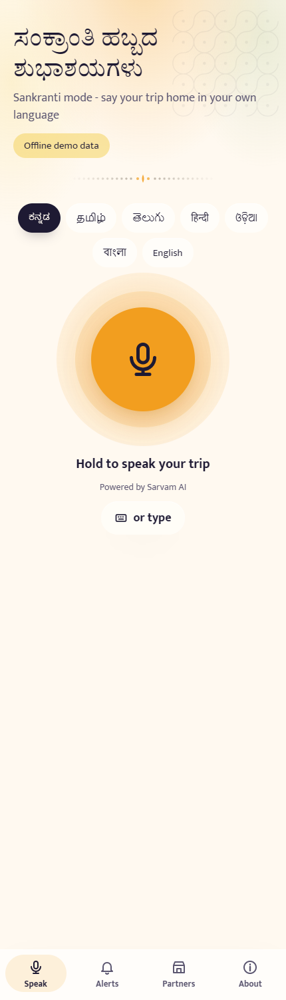
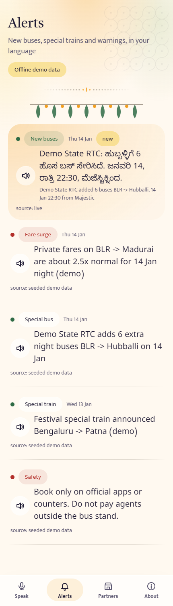
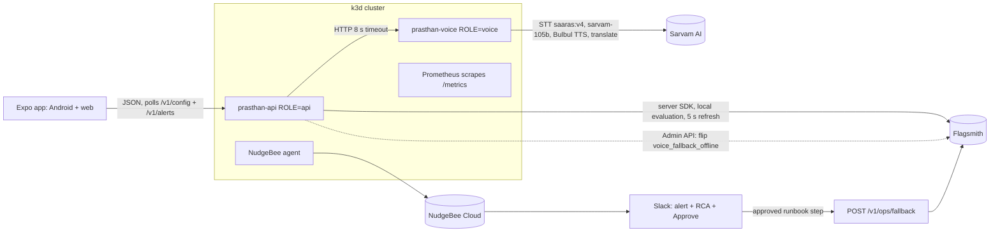

# Prasthan (ಪ್ರಸ್ಥಾನ, "setting out on a journey")

**Say your festival trip home in your own language. Prasthan understands it, sends you to the official booking sites, warns you about rush nights and touts, and tells you the moment a new bus opens. And it shows bus operators the buses that are missing.**

> "redBus shows the buses that exist. We show operators the buses that are missing."

- Every festival, lakhs of people leave Bengaluru on the same two nights. Bengaluru "pretty much came to a standstill" on 17-18 Oct 2025 as people left for Deepavali.
- Private bus fares go 2-3x on those nights; operators add special buses late, after the crowd is already at the bus stand.
- Travellers (and their parents, who may only speak Kannada, Tamil or Odia) keep refreshing four apps, and touts at Majestic fill the gap.

**Live demo (offline web build, seeded demo data):** https://prasthan-ten.vercel.app
**Demo video:** `<VIDEO_URL>`

Built at Festive Hacks, 25 Nov 2026, BIEC Bengaluru. Sponsors used: **Sarvam AI, Flagsmith, NudgeBee**.

---

## What it does

**Traveller (Manjunath, home is Hubballi)**
1. Picks a language (Kannada default) and holds the mic: *"ಸಂಕ್ರಾಂತಿಗೆ ಹುಬ್ಬಳ್ಳಿಗೆ ಊರಿಗೆ ಹೋಗ್ತಾ ಇದ್ದೀನಿ, ಗುರುವಾರ ರಾತ್ರಿ, ಬಸ್ಸಲ್ಲಿ, ಇಬ್ರು"* (or types / taps a sample).
2. A trip card appears: Bengaluru -> Hubballi, Thu 14 Jan, night, bus, 2 people. Every field can be fixed with a tap. If something is missing, the app asks ("ಯಾವ ದಿನ?").
3. The reply is spoken back in Kannada. Official booking links (KSRTC, redBus, AbhiBus, Zingbus, FlixBus; IRCTC, ixigo for trains). **No prices, no ranking, no scraping.**
4. Warnings: "14 Jan is a rush night" + "book only on official apps; never pay an agent outside the bus stand".
5. "Alert me when a new bus opens" (a diya lights up).
6. Later the alert arrives and is spoken in his language: *"Demo State RTC: ಹುಬ್ಬಳ್ಳಿಗೆ 6 ಹೊಸ ಬಸ್ ಸೇರಿಸಿದೆ..."*

**Bus operator (Demo State RTC)**: one demand board: "BLR -> Hubballi, Thu 14 Jan: 2,400 want, 880 seats, gap 1,520, add 38 buses". Tap **Add buses** -> 6 buses, 22:30, Majestic -> "6 buses added. 16 waiting travellers notified."

**Sweet shop near Majestic**: pre-orders per pickup day: "Prepare 9 kg Mysore pak by 20:00" (gifting add-on, staged rollout). **Quick commerce**: a roadmap view on seeded data (where and when travellers leave, what they want before departure).

Screenshots (live web build, seeded demo data):

| Speak + trip card | Warnings, official links, Alert me | Kannada new-bus alert |
|---|---|---|
|  |  |  |

Operator demand board after "Add 6 buses" ("16 waiting travellers notified"):


---

## Quick start (offline, no keys, about 5 minutes)

Prerequisites: Node 22+ (tested on Node 24), npm, git.

```bash
git clone https://github.com/Ankith-m1006/prasthan.git && cd prasthan
cp .env.example .env                              # all keys can stay empty
cp apps/mobile/.env.example apps/mobile/.env      # app talks to http://localhost:8787
npm --prefix services/api install
npm --prefix apps/mobile install
```

Run (two terminals):

```bash
MOCK_ALL=1 npm --prefix services/api run dev      # api on http://localhost:8787 (Windows PowerShell: $env:MOCK_ALL=1; npm --prefix services/api run dev)
npm --prefix apps/mobile run web                  # app on http://localhost:8081
```

Or both at once: `npm run dev` (root; uses `npx concurrently`). With no keys the api uses its mock modes automatically.

Checks: `npm --prefix services/api run check` (TypeScript + 57 tests, no network) and `npm --prefix apps/mobile run typecheck && npm --prefix apps/mobile test`.

Fully offline web app (no api at all): `cd apps/mobile && EXPO_PUBLIC_APP_MOCK=1 npx expo export --platform web` then `npm run serve-web`. This is what the live demo link runs; the About tab has "Demo switches" that simulate the Flagsmith flips (festival mode, offline-voice fallback, gifting rollout).

Try it: Speak tab -> "or type" -> tap the Kannada sample -> Alert me -> Partners tab -> Demo State RTC -> Add buses -> Alerts tab.

## Live setup (with keys)

Keys go only in `.env` (git-ignored). The api logs only `NAME: SET|MISSING`.

| Service | What to set | Notes |
|---|---|---|
| Sarvam AI | `SARVAM_API_KEY`, `SARVAM_MODE=live` | dashboard.sarvam.ai; free credits. STT/LLM/TTS go live; anything failing falls back. |
| Flagsmith | `FLAGSMITH_SERVER_KEY` (+ `FLAGSMITH_ADMIN_API_KEY`, `FLAGSMITH_PROJECT_ID`, `FLAGSMITH_ENVIRONMENT_API_KEY` for the ops flip) | Create the flags/segments from `config/flagsmith/flags.json` (import script by the venue session, or by hand). |
| Ops | `OPS_TOKEN` | shared secret for `POST /v1/ops/*` (NudgeBee runbook / scripts). |
| NudgeBee + k3d | NudgeBee Cloud account, agent Helm install in the k3d cluster, Slack | Manifests and runbook: `infra/k8s/`, `docs/NUDGEBEE-RUNBOOK.md`, `docs/K8S-TEMPLATES.md` (venue session, see `status/C.md`). |

Run the api as two services like in k8s: `ROLE=voice PORT=8788 npm --prefix services/api start` and `ROLE=api VOICE_URL=http://localhost:8788 npm --prefix services/api start`.

Stage tools (no dependencies): `node infra/load/rush.mjs --url http://localhost:8080 --minutes 2` (rush; voice calls carry `x-load-test: 1` so they never spend Sarvam credits), `node scripts/demo-break.mjs`, `node scripts/demo-fix.mjs`, `node scripts/demo-reset.mjs` (all have `--help`).

## Architecture



- One codebase, one image; `ROLE=all|api|voice`. If the voice service is down, or `voice_fallback_offline` is on, the api answers with the rule parser + saved audio clip + big text, so nobody is stranded.
- API contract: `docs/ARCHITECTURE.md` and `shared/contract/` (TypeScript types + JSON Schemas + examples, validated in tests).
- Code: `services/api` (Fastify 5 + TypeScript), `apps/mobile` (Expo SDK 58, expo-router, react-native-web), `infra/`, `scripts/`.

## How we use each sponsor (and what breaks without it)

### Sarvam AI: every traveller can speak, in their own language
- **Saaras v4 STT** (`saaras:v4`, mode from the `stt_mode` flag, default `codemix` for Kannada-English): the traveller's voice note -> text.
- **sarvam-105b** (chat completions, JSON only, validated with a JSON Schema, one retry, then the rule parser): text -> structured `TripIntent` (town, date, time, mode, people, festival, gift).
- **Bulbul TTS** (`tts_model` + `tts_speaker` flags): the reply and every new-bus alert are spoken back in the traveller's language.
- **Translate** (Mayura): client and internal `/voice/translate` route are in place; today the new-bus alerts use per-language templates (7 languages), translation is the next step.
- Without Sarvam: the app still works by typing (rule parser), but the parents who only speak Kannada can't use it.
- Load tests never hit Sarvam (`x-load-test: 1` -> mock client), so the rush can't burn credits or trip the 60/min limit.

### Flagsmith: runs the festival, per traveller and per business
| Flag | Type | What it changes | Who it targets |
|---|---|---|---|
| `festival_mode` | JSON | theme, greeting, which festival's rush nights count | default Sankranti; segment `tamil_travellers` -> Pongal mode |
| `route_config` | JSON | enabled + featured routes | everyone |
| `surge_warning` | JSON | rush nights, tout warning on/off | everyone |
| `special_service_announcements` | JSON | ops announcements merged into the alerts feed | everyone |
| `voice_enabled` | bool | master kill switch for live voice | everyone |
| `voice_fallback_offline` | bool | skip Sarvam: rule parser + saved audio + text (the switch NudgeBee flips) | everyone |
| `tts_model` | string | Bulbul model routing | segment `odia_speakers` -> `bulbul:v3` |
| `tts_speaker` | JSON | speaker per model | everyone |
| `stt_mode` | string | Saaras mode (transcribe / codemix / translate) | everyone |
| `gifting_enabled` | bool | sweets pre-order card | segment `gifting_pilot_20pct` (percentage split), then 100% |
| `operator_add_service` | bool | "Add buses" button (also enforced by the api: 403 if off) | segment `bus_operators` |
| `shop_orders_view` | bool | pre-orders view | segment `sweet_shops` |
| `quick_commerce_view` | bool | quick-commerce board | segment `quick_commerce` |
| `live_data_source` | string | seeded alerts vs context.dev news | everyone |
| `deep_link_providers` | JSON | order and set of booking links per mode (drop a broken one live) | everyone |
| `alert_poll_seconds` | number | how often apps poll (slow clients down in a rush) | everyone |
| `reply_style` | multivariate | warm vs short spoken reply | 50/50 |

Traits sent from the app (`/v1/identify`): `role`, `language`, `home_state`, `home_town`, `partner_type`, `partner_id`. The app never holds a Flagsmith key; the api evaluates flags per identity (local evaluation, 5 s refresh, coded defaults if Flagsmith is unreachable). The ops endpoint flips `voice_fallback_offline` through the Admin API.
Without Flagsmith: one hard-coded festival, every business sees every tool, and the only fix on the rush night is a redeploy.

### NudgeBee: keeps the rush night up
- The api and voice services run on Kubernetes (k3d) with Prometheus scraping `/metrics` (`http_requests_total`, latency histogram, `voice_errors_total`, `fallback_active`).
- Story: "special buses just opened" rush (`infra/load/rush.mjs`) + the voice pod crashes (`FAULT_MODE=crash_on_voice`, a demo tool) -> NudgeBee alert + root cause in Slack -> Approve -> runbook flips Flagsmith `voice_fallback_offline` -> travellers keep getting answers -> voice restored -> flag back off. `scripts/demo-break.mjs` prints "traveller answers: OK" every 5 s to prove nobody is stranded.
- Honest line: the crash is injected on purpose; the detection, explanation and approved fix are NudgeBee's. Without NudgeBee: a 2 a.m. crash loop that nobody explains, and a human guessing which switch to flip.

context.dev: optional live news alerts behind the `live_data_source` flag (not a sponsor; off by default).

## Demo data
All travellers, demand numbers, operators, shops and orders in `seed/` are **synthetic** and labelled "Seeded demo data" in the app. Festival dates for Sankranti/Pongal 2027 were checked (Drik Panchang). Real brands appear only as text links to their public sites: no logos, no scraping, no prices, no ticket sales, no payments ("pay at pickup (demo)").

## Limits (honest)
- Built on a laptop without sponsor keys for most of the day: the live Sarvam and Flagsmith paths are tested with fakes in unit tests; field names checked on docs.sarvam.ai today, a few marked UNVERIFIED in `services/api/src/sarvam/live.ts`. Live checks happen at the venue.
- The public web demo runs fully offline: mock voice (sample sentences), browser speech voice if your browser has one for the language, simulated Flagsmith switches. The real voice + flags need the api with keys.
- Audio cannot be understood in offline-fallback mode; the app then asks the traveller to type or pick a sample.
- Demand "want" numbers are seeded; saved trips do not change them. The store is in memory (restart = reset).
- Kannada lines checked by Ankith; Tamil, Telugu, Hindi, Odia and Bengali text is best effort.
- Only Kannada fonts are bundled (Mukta, Tiro Kannada, Noto Sans Kannada); other scripts use the system font.
- No real operator integrations, no auth (partner picker), no payments.

## Roadmap
1. Pilots with a state RTC planning desk (demand 7 days before the rush).
2. WhatsApp voice notes as the input channel.
3. Quick-commerce partners: departure-time gift delivery + hometown demand on festival morning.
4. Trains: waitlist-aware alerts (deep links only).

## AI use
This project was built during Festive Hacks on 25 Nov 2026 (code from 11:30 IST). Code was written with AI coding assistants, OpenAI Codex and Claude Code, following prompts and docs Ankith prepared the night before (`docs/`, `codex/`, and the synthetic `seed/` data; that prep commit contains no code). Ankith chose the problem, designed the product and architecture, reviewed and ran the code, and can explain every part. Prep docs were also drafted with AI help.

## Credits and licences
- Fonts: Mukta, Tiro Kannada, Noto Sans Kannada (SIL Open Font License) via `@expo-google-fonts`.
- Icons and motifs (kolam, temple line, toran, diya, route line): drawn in code by us with react-native-svg.
- "Powered by Sarvam AI" shown as plain text next to the mic and on the About tab. No sponsor or brand logos are used.
- Booking sites (KSRTC, redBus, AbhiBus, Zingbus, FlixBus, IRCTC, ixigo, MakeMyTrip) and quick-commerce names are plain text links only.

Built at **Festive Hacks, 25 Nov 2026, BIEC Bengaluru**.
